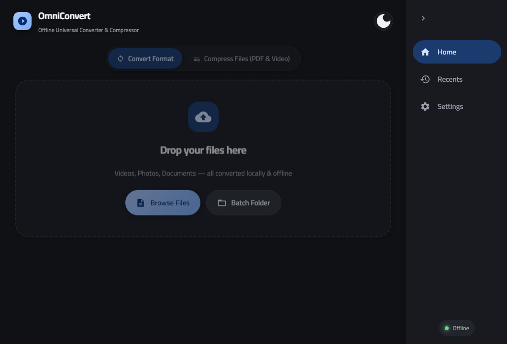
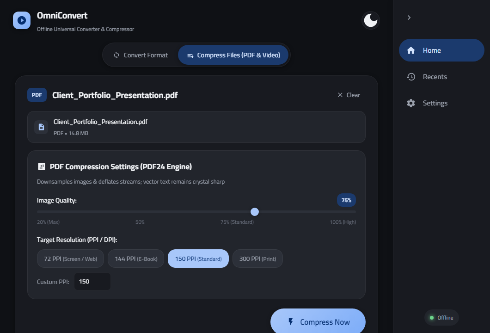
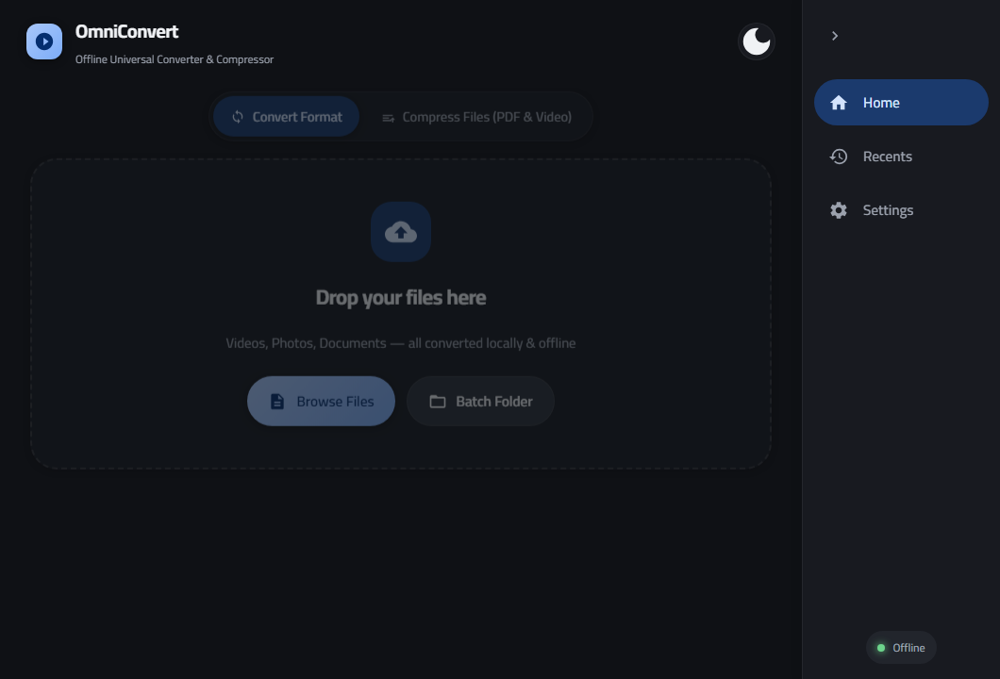
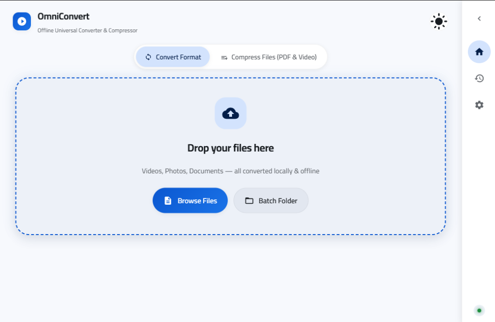

# OmniConvert

Universal Offline File Converter and Compressor for Windows, built with modern C++20 and a sleek Material You (Material 3) user interface.

[](https://github.com/nf5054/File-Converter)
[](https://en.cppreference.com/w/cpp/20)
[-6750A4.svg)](https://m3.material.io/)
[](https://github.com/nf5054/File-Converter)

---

## Overview

OmniConvert is a desktop file transformation application designed to provide fast, high-quality format conversion and media compression without ever sending your files to cloud servers. All conversions, compressions, and stream processing happen 100% locally on your machine.

---

## Screenshots

### Home Screen - Conversion Mode (Dark Theme)


### Compression Mode (PDF24-Style Quality & PPI Downsampling)


### Settings and System Integration


### Light Theme Interface


---

## Features

### 1. 100% Offline and Private
* No internet connection required.
* Zero cloud uploads; your sensitive files and documents never leave your local storage.
* Fast, local multi-threaded pipeline execution.

### 2. Material You (Material 3) Design
* Clean, uncluttered layout with no redundant footers or intrusive banners.
* Collapsible right navigation rail that collapses to 72px (showing SVG vector icons) and expands to 210px (showing icons with text labels).
* Built-in Dark and Light theme toggle with instantaneous CSS variable switching.
* High-legibility Cairo typography bundled locally.

### 3. PDF Compression (PDF24 Engine Style)
* Direct control over embedded image downsampling and quality:
  * Image Quality Slider: Adjust JPEG compression from 20% to 100%.
  * Target Resolution (PPI) Selection: Quick presets for 72 PPI (Screen/Web), 144 PPI (E-Book), 150 PPI (Standard), and 300 PPI (High Print).
  * Custom PPI: Enter any custom resolution value directly.
* Deflates document streams and optimizes xref tables while preserving vector text, links, and layout geometry.

### 4. Video Compression
* Compression Level Slider: Dynamically adjusts H.264 Constant Rate Factor (CRF) between 18 (visually lossless) and 38 (maximum compression).
* Resolution Downscaling: Downscale on the fly to 1080p Full HD, 720p HD, or 480p SD.
* Audio Re-encoding: Optimized 128 kbps AAC stereo encoding for size reduction.

### 5. Genuine Real-Time Live Progress
* Built using Win32 anonymous pipes (`CreatePipe`) to capture stdout/stderr from backend engines in real time.
* Displays live percentages, elapsed times, and current processing stages without lag or artificial delays.
* Cancel Button: Allows immediate cancellation and clean termination of child processes without application freezes.

### 6. Windows Shell Integration
* Native OLE Drag and Drop (`IDropTarget` and `CF_HDROP` support).
* File Explorer Right-Click Context Menu integration for files and folders.
* Optional Windows Startup registration via system registry helpers.
* Native "Show in Explorer" functionality (`SHOpenFolderAndSelectItems`) to automatically highlight the target output file.

---

## Supported Formats

| Category | Formats | Supported Conversions |
| :--- | :--- | :--- |
| Documents | PDF, DOCX, DOC, PPTX, PPT, TXT, MD | Word to PDF, PDF to Word, PowerPoint to PDF, Text/Markdown to PDF, PDF to Text |
| Video | MP4, MKV, AVI, MOV, WEBM, WMV, FLV, M4V, TS, 3GP | Transcoding between all formats, GIF creation, H.264/AAC re-encoding |
| Audio Extraction | MP3, WAV, AAC | Direct audio extraction from any video stream |
| Images | PNG, JPG, JPEG, WEBP, BMP, ICO, TIFF, SVG | Cross-format conversion, quality compression, transparency preservation |

---

## Download and Installation

### Pre-built Release (Windows x64)

1. Download the latest release package: `OmniConvert-v1.0.0-windows-x64.zip` from the [Releases](https://github.com/nf5054/File-Converter/releases) page.
2. Extract the archive to any folder of your choice.
3. Run `Launch_OmniConvert.bat` or `OmniConvert.exe`.

---

## Building From Source

### Prerequisites

* Windows 10 or Windows 11 (64-bit)
* GCC with C++20 support (e.g. MSYS2 UCRT64 / MinGW-w64) or MSVC 2022
* Microsoft Edge WebView2 Runtime (installed by default on Windows 10/11)
* Python 3.10+ with `pymupdf`, `pillow`, `python-docx`, `reportlab`, `pdf2docx`
* FFmpeg (installed in PATH, WinGet directory, or placed alongside `OmniConvert.exe`)

### Build Steps

1. Clone the repository:
   ```cmd
   git clone https://github.com/nf5054/File-Converter.git
   cd File-Converter
   ```

2. Run the build script:
   ```cmd
   build.bat
   ```
   Or invoke the compiler directly:
   ```cmd
   g++ -std=c++20 -O2 -mwindows -municode src/main.cpp src/converter.cpp src/registry_helper.cpp -I include -I src -lole32 -luuid -lshlwapi -ldwmapi -lcomdlg32 -lshell32 -o OmniConvert.exe
   ```

3. Run the compiled executable:
   ```cmd
   OmniConvert.exe
   ```

---

## Repository Structure

```text
File-Converter/
|-- assets/
|   |-- fonts/                     # Bundled offline Cairo font family
|   |-- screenshots/               # Application preview screenshots
|-- include/
|   |-- WebView2.h                 # WebView2 COM interface headers
|   |-- WebView2EnvironmentOptions.h
|-- src/
|   |-- main.cpp                   # Win32 entry point, OLE IDropTarget, WebView2 host
|   |-- converter.cpp              # Process execution, anonymous pipe reader, FFmpeg wrapper
|   |-- converter.hpp              # Engine definitions and options
|   |-- doc_converter.py           # Document conversion & PDF compression backend
|   |-- registry_helper.cpp        # Context menu and startup registry handlers
|   |-- registry_helper.hpp
|-- ui/
|   |-- index.html                 # Material You interface structure
|   |-- style.css                  # Modern M3 styling, animations, and color tokens
|   |-- app.js                     # Interactive UI state, tabs, sliders, bridge logic
|-- build.bat                      # Build script for Windows
|-- doc_converter.py               # Engine copy for portable root execution
|-- Launch_OmniConvert.bat         # Fast launcher script
|-- README.md                      # Documentation
`-- WebView2Loader.dll             # WebView2 loader binary
```

---

## License

This project is released under the MIT License.
